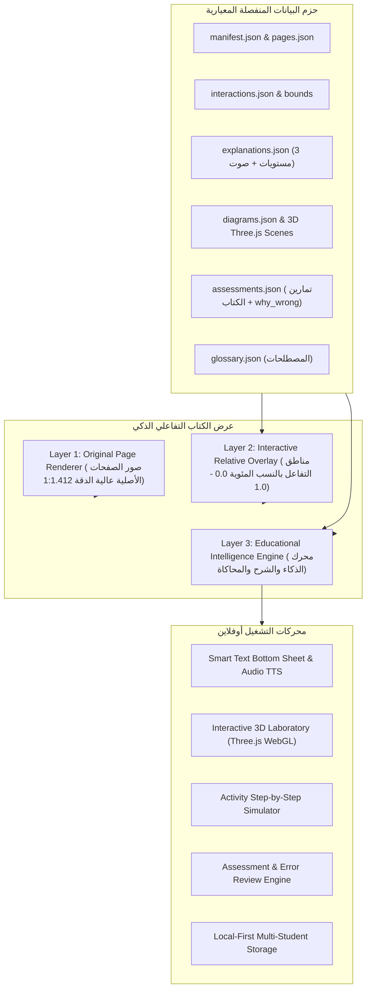

# ذاكر — تقرير الفحص والتدقيق الهندسي وخطة محرك الكتب التفاعلية الذكية
## Phase 0: Repository Audit & Interactive Textbook Engine Architecture

**التاريخ:** 24 نوفمبر 2026  
**المشروع الأول:** كتاب العلوم — الجزء الثاني — الصف التاسع الأساسي  
**المرجع:** `science_part2_9th.pdf` (154 صفحة، 8 وحدات، 31 درساً، 8 تقويمات وحدات)

---

### 1. تدقيق وفحص المشروع الحالي (Current State Audit)

| العنصر | الوضع الحالي | التقييم الهندسي والمعالجة المطلوبة |
|---|---|---|
| **طريقة عرض الكتاب حالياً** | رسم نصوص ملخصة على كانفاس 2D بواسطة Three.js في `science-9th-book.html` دون استخدام صفحات الكتاب الأصلية. | **قصور جوهري:** لا يرى الطالب شكل الكتاب الوزاري الأصلي. **المعالجة:** اعتماد Layer 1 Page Renderer يعرض صفحات الكتاب الأصلية بدقة عالية واستخراج مباشر من PDF. |
| **تضمين صفحات PDF والصور** | ملف PDF مضمن بالكامل بحجم 51.14 ميغابايت داخل أصول التطبيق، ويُفتح عبر قارئ PDF خارجي/منفصل في أندرويد. | **المعالجة:** استخراج الصفحات كصور محسنة WebP/JPEG مع نظام تحميل كسول (Lazy Loading) وذاكرة تخزين مؤقت (Cache) وتكبير ذكي دون تشويه. |
| **محرك التجارب ثلاثية الأبعاد** | استخدام Three.js r128 لتوليد مجسمات مبسطة على نصف الشاشة. | **المعالجة:** فصل المشاهد إلى `Interactive 3D Science Engine` يرتبط برسمة الكتاب الأصلية مباشرة عند النقر عليها، مع حسابات فيزيائية وكيميائية دقيقة ودوران 360 درجة وتفكيك الأجزاء. |
| **بنك الأسئلة والتقييم** | حزمة `science_g9_p2_pack.json` تحوي 48 سؤالاً مربوطة بـ `why_wrong`. | **المعالجة:** تحويل أسئلة وتمارين الكتاب الوزاري الأصلية إلى عناصر تفاعلية في Layer 2 و Layer 3 مع الحفاظ على صيغتها في صفحة التقويم. |
| **نظام الحفظ المحلي** | حفظ مبسط في `localStorage` لمفتاح واحد. | **المعالجة:** محرك `student-storage.js` يدعم تعدد ملفات الطلاب (Multi-Profile)، وحفظ آخر صفحة، والأسئلة المحلولة، ومراجعة الأخطاء دون أي اتصال بالإنترنت. |
| **تقنية بناء APK** | سكريبت `build_apk.py` مخصص لأدوات أندرويد (aapt2, javac, d8, apksigner) بحجم 95 ميغابايت. | **الحفاظ الكامل والتحسين:** الحفاظ على هيكل البناء السريع، مع دمج الأصول الجديدة وحزم البيانات. |
| **الوضع الفاتح والداكن** | مدعوم في واجهة أندرويد والقوائم المنبثقة. | **المعالجة:** الحفاظ على ألوان وهوية الصفحة الوزارية الأصلية دون تشويه مع دعم الوضع الداكن في الأشرطة والقوائم ونوافذ الشرح السفلية (Bottom Sheets). |
| **الأصول القابلة لإعادة الاستخدام** | مكتبة Three.js r128 المضمنة، أيقونات SVG، مصنّع الصوت `SoundSynth` عبر Web Audio API، خط Tajawal. | **إعادة استخدامها وتوسيعها:** ترقية `SoundSynth` لدعم الصوت العربي وقراءة النصوص وتشجيع اللهجة اليمنية البيضاء. |

---

### 2. جرد وتحليل محتوى كتاب العلوم (الجزء الثاني)

- **إجمالي الصفحات:** 154 صفحة.
- **الصفحات غير التعليمية (المستبعدة من التفاعل المباشر مع الحفاظ على الفهرس):**
  - ص 1: الغلاف الخارجي.
  - ص 2: الغلاف الداخلي وعنوان الكتاب.
  - ص 3: النشيد الوطني للجمهورية اليمنية.
  - ص 4: تصدير وزارة التربية والتعليم.
  - ص 5: مقدمة فريق التطوير.
  - ص 154: الغلاف الخلفي.
- **الصفحات التعليمية (146 صفحة):**
  - ص 6 – 7: فهرس المحتويات الكامل.
  - ص 8 – 153: الوحدات التعليمية الثمانية (الوحدات 9 إلى 16):

| الوحدة | العنوان الأصلي | المجال | أرقام صفحات الكتاب | عدد الدروس | أهم الرسومات العلمية والأنشطة |
|---|---|---|---|---|---|
| **الوحدة 9** | تفاعلات العناصر والمركبات | كيمياء | ص 7 – 29 | 6 دروس + تقويم | احتراق الماغنيسيوم، أكسدة الكبريت، تحضير CO2، تكرير النفط |
| **الوحدة 10** | الهالوجينات | كيمياء | ص 30 – 39 | 3 دروس + تقويم | تحضير غاز الكلور، قصر الألوان، خواص الفلور والبروم واليود |
| **الوحدة 11** | خواص الأجسام | فيزياء ومادة | ص 40 – 75 | 7 دروس + تقويم | التوتر السطحي، الأنابيب الشعرية، لزوجة السوائل، مقياس الصلادة |
| **الوحدة 12** | الضغط في المواد الصلبة والموائع | فيزياء | ص 76 – 93 | 3 دروس + تقويم | تجربة تورشيللي، البارومتر، ضغط السوائل وقاعدة باسكال |
| **الوحدة 13** | الطاقة الشمسية واستغلالها | فيزياء وتطبيقات | ص 94 – 106 | 3 دروس + تقويم | السخان الشمسي، المجمع الحراري، الخلايا الكهروضوئية |
| **الوحدة 14** | الإنسان يستثمر موارد البيئة الحية | أحياء وبيئة | ص 107 – 125 | 2 درسان + تقويم | السلاسل الغذائية، التوازن البيئي، الصناعات الزراعية والحيوانية |
| **الوحدة 15** | رعاية الأمومة والطفولة | صحة وأحياء | ص 126 – 135 | 3 دروس + تقويم | تغذية الجنين، الرضاعة الطبيعية، مراحل نمو الطفل |
| **الوحدة 16** | الوراثة في الكائنات الحية | علم الوراثة | ص 136 – 152 | 4 دروس + تقويم | تجارب مندل، الكروموسومات، الطفرات الجينية، الأمراض الوراثية |

---

### 3. الصفحات الثلاث المختارة للنموذج الأولي (Phase 1 Proof of Concept)

تم اختيار ثلاث صفحات نموذجية تغطي الركائز الثلاث المطلوبة بأعلى دقة:

1. **الصفحة الأولى: المفاهيم والتعريفات (Concept & Definition Page)**
   - **كتاب الوزارة ص 10 (PDF ص 11)**:
     - *المفهوم:* الإطار الذهبي لتعريف الأكسدة والأكاسيد الفلزية (`Na2O`, `MgO`, `Al2O3`).
     - *التفاعل:* النقر على النص لفتح نافذة الشرح بـ 3 مستويات (مبسط، متوسط، متعمق)، مع قراءة صوتية محلية، ومصطلحات علمية تفاعلية، ومعادلات كيميائية حية.
2. **الصفحة الثانية: الرسم العلمي والمجسم ثلاثي الأبعاد (Scientific Diagram to 3D Model)**
   - **كتاب الوزارة ص 20 (PDF ص 21)**:
     - *الرسم:* الشكل (1) — جهاز تحضير غاز ثاني أكسيد الكربون في المختبر (زجاجة وولف، قمع طويل، مخبار الإزاحة).
     - *التفاعل:* النقر على الرسمة يفتح محاكاة ثلاثية الأبعاد تفاعلية 360° لجهاز المعمل، مع تفاعل حقيقي (إضافة الحمض إلى كربونات الكالسيوم، تصاعد الفقاعات، قياس الغاز، وعرض أسماء المكونات عند لمسها).
3. **الصفحة الثالثة: أنشطة وتمارين الكتاب الأصلية (Authentic Exercises & Assessment)**
   - **كتاب الوزارة ص 29 (PDF ص 30)**:
     - *المحتوى:* صفحة «تقويم الوحدة التاسعة» الأصلية.
     - *التفاعل:* تحويل أسئلة الصح والخطأ والتعليل العلمي والمقارنة إلى عناصر قابلة للحل والتصحيح الفوري مع تعليل سبب الخطأ لكل اختيار (`why_wrong`) وحفظ التقدم محلياً.

---

### 4. معمارية المحرك متعدد الطبقات (Multi-Layer Architecture)

