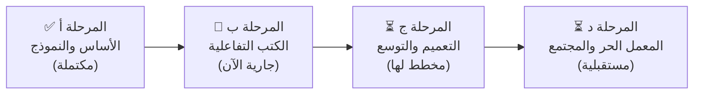
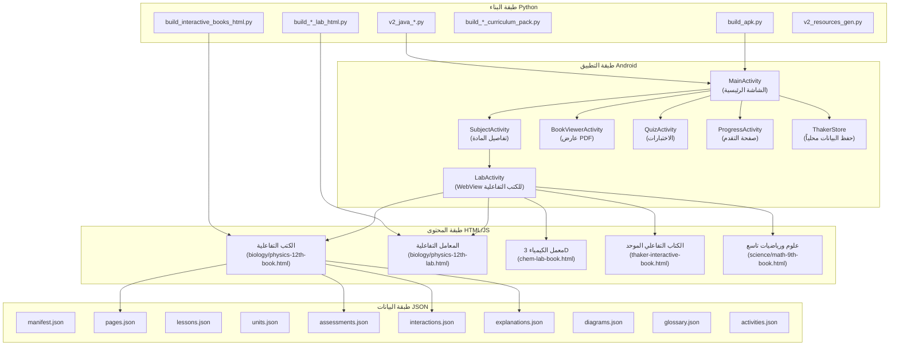
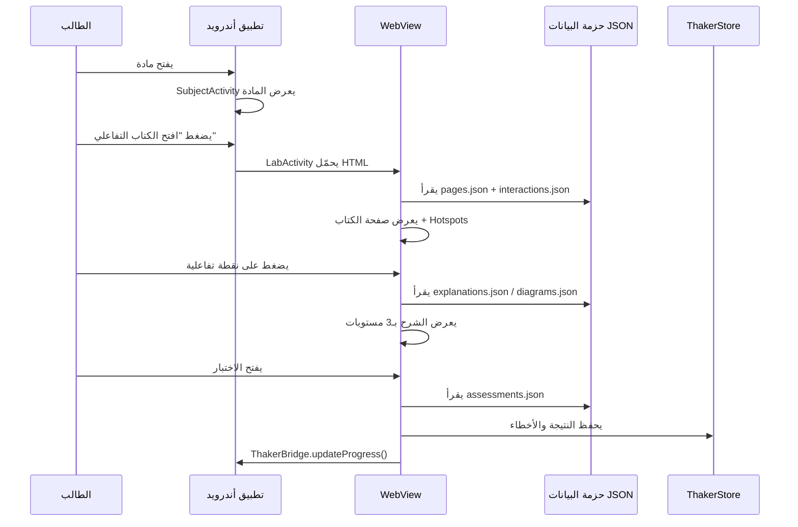
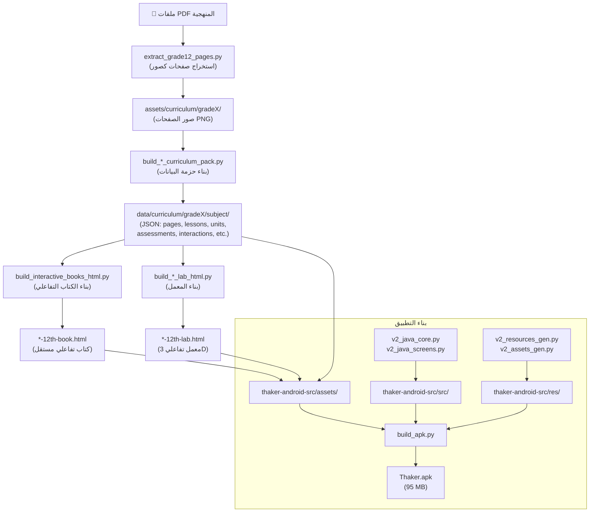
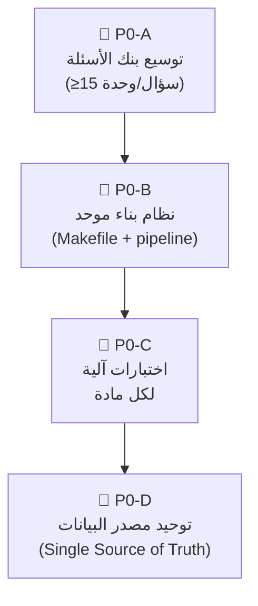

<div dir="rtl">

# 🔬 التحليل الشامل لتطبيق «ذاكر» — التطبيق التعليمي الوطني اليمني

**التاريخ:** 25 نوفمبر 2026 · **الإصدار:** 1.0  
**الغرض:** وثيقة مرجعية شاملة لأي AI Agent أو مطوّر يعمل على المشروع

---

## الجزء الأول: نظرة عامة وملخص تنفيذي

### 1.1 ما هو ذاكر؟
**ذاكر** هو تطبيق تعليمي تفاعلي وطني يمني يعمل **100% بدون إنترنت** (Offline-First)، يستهدف طلاب المرحلتين الإعدادية والثانوية في الجمهورية اليمنية. يدمج بين:
- **الكتب المدرسية التفاعلية** مع طبقات ذكية فوق صفحات الكتاب الأصلية
- **المعامل الافتراضية ثلاثية الأبعاد** (Three.js)
- **بنك أسئلة وزارية موثّقة** مع تعليل الإجابات الخاطئة
- **نظام تتبع تقدم** وحفظ حالة الطالب

### 1.2 الحالة الحالية (ملخص)



| المؤشر | القيمة |
|---|---|
| **المراحل المغطاة** | الصف 9 (علوم + رياضيات) + الصف 12 (أحياء + فيزياء + كيمياء) |
| **الكتب التفاعلية HTML** | 8 ملفات (biology, physics, chemistry books + labs + science9 + math9 + thaker-interactive) |
| **إجمالي الأسئلة** | 200 سؤال (84 للأحياء/الفيزياء/الكيمياء + 116 للعلوم تاسع) |
| **إجمالي Hotspots التفاعلية** | 952 نقطة تفاعل فوق صفحات الكتب |
| **التجارب ثلاثية الأبعاد** | 10 تجارب كيمياء + تجارب فيزياء وأحياء مدمجة |
| **حجم APK** | ~95 ميجابايت |
| **كود Java (أندرويد)** | 2,945 سطر في 13 ملف |
| **سكريبتات البناء Python** | 24,819 سطر في 16 ملف |
| **ملفات PDF المتاحة** | 9 كتب ثالث ثانوي + 4 كتب تاسع |

---

## الجزء الثاني: المعمارية التقنية

### 2.1 الهيكل العام للمشروع



### 2.2 تدفق البيانات (Data Flow)



### 2.3 مكونات التطبيق (Android Activities)

| النشاط (Activity) | الأسطر | الوظيفة |
|---|---|---|
| `MainActivity` | 524 | الشاشة الرئيسية مع 5 تبويبات (رئيسية، المواد، المكتبة، المفضلة، الإعدادات) |
| `SubjectActivity` | 271 | تفاصيل المادة وأجزائها وأزرار الفتح |
| `BookViewerActivity` | 588 | عارض PDF مع تقليب الصفحات وحفظ المكان |
| `LabActivity` | 117 | WebView لتشغيل الكتب التفاعلية HTML مع جسر ThakerBridge |
| `QuizActivity` | 315 | نظام الاختبارات التفاعلي |
| `SummaryActivity` | 294 | عرض نتائج الاختبار وتحليل الأداء |
| `ProgressActivity` | 191 | عرض إحصائيات التقدم والشارات |
| `OnboardingActivity` | 208 | شاشة الإعداد الأولي (الاسم، الصف، الامتحان) |
| `SplashActivity` | 52 | شاشة البداية |
| `ThakerStore` | 243 | إدارة SharedPreferences (التقدم، التفضيلات، الأخطاء) |
| `ThemeUtil` | 18 | إدارة الثيم (فاتح/داكن) |
| `NavBarHelper` | 56 | شريط التنقل السفلي المشترك |
| `RingProgressView` | 68 | عنصر رسومي دائري للتقدم |

---

## الجزء الثالث: خريطة المحتوى الحالي

### 3.1 الصف الثالث الثانوي (Grade 12)

#### أ) الأحياء (Biology)
| البند | القيمة |
|---|---|
| الوحدات | 8 وحدات (الجهاز العصبي → تاريخ الأرض) |
| الصفحات | 219 صفحة (pages.json: 2,410 سطر) |
| الدروس | 474 سطر lessons.json |
| الأسئلة | 24 سؤال في 8 مجموعات |
| التفاعلات | 312 نقطة تفاعل فوق 190 صفحة |
| الكتاب التفاعلي | `biology-12th-book.html` (5,353 سطر / 1.18 MB) |
| المعمل | `biology-12th-lab.html` (920 سطر / 705 KB) |

#### ب) الفيزياء (Physics)
| البند | القيمة |
|---|---|
| الوحدات | 9 وحدات (كمية التحرك → الفيزياء الكونية) |
| الصفحات | 213 صفحة (pages.json: 2,344 سطر) |
| الدروس | 533 سطر lessons.json |
| الأسئلة | 27 سؤال في 9 مجموعات |
| التفاعلات | 268 نقطة تفاعل فوق 179 صفحة |
| الكتاب التفاعلي | `physics-12th-book.html` (5,353 سطر / 1.21 MB) |
| المعمل | `physics-12th-lab.html` (1,160 سطر / 715 KB) |

#### ج) الكيمياء (Chemistry)
| البند | القيمة |
|---|---|
| الوحدات | 9 وحدات (العناصر الانتقالية → الكيمياء والبيئة) |
| الصفحات | 187 صفحة (pages.json: 2,058 سطر) |
| الدروس | 575 سطر lessons.json |
| الأسئلة | 33 سؤال في 9 مجموعات |
| التفاعلات | 211 نقطة تفاعل فوق 178 صفحة |
| التجارب 3D | 10 تجارب كاملة في `chem-lab-book.html` |
| المعمل المعياري | `chem-lab/src/` (HTML + CSS + JS + questions.json) |

### 3.2 الصف التاسع (Grade 9)

| المادة | المحتوى | الملف |
|---|---|---|
| **العلوم (ج2)** | 15 مجموعة اختبار، 116 سؤال، 161 نقطة تفاعل | `thaker-interactive-book.html` (12,646 سطر) |
| **العلوم (ج1)** | كتاب تفاعلي 3D | `science-9th-book.html` (3,223 سطر) |
| **العلوم (تفاعلي)** | 13 درساً تفاعلياً | `science9-interactive.html` (3,223 سطر) |
| **الرياضيات** | كتاب تفاعلي 3D | `math-9th-book.html` (2,433 سطر) |

### 3.3 ملفات PDF المصدرية المتاحة

#### ثالث ثانوي (9 كتب):
| المادة | الملف | الحجم |
|---|---|---|
| الفيزياء | `كتاب-فيزياء-ثالث-ثانوي-اليمن.pdf` | 16 MB |
| الأحياء | `الأحياء-للصف-الثالث-الثانوي.pdf` | 32 MB |
| الكيمياء | `كتاب-الكيمياء-ثالث-ثانوي.pdf` | 11 MB |
| الإيمان | `كتاب-الإيمان-ثالث-ثانوي-اليمن.pdf` | 9.9 MB |
| الأدب والنقد | `الأدب-والنصوص-والنقد-للصف-الثالث-الثانوي.pdf` | 7.5 MB |
| الإنجليزي (كتاب التمارين) | `english_work_12th (1).pdf` | 7.1 MB |
| الرياضيات (تمارين) | `الرياضيات-التمارين-للصف-الثالث-الثانوي.pdf` | 6.1 MB |
| القراءة | `القراءة-ثالث-ثانوي.pdf` | 5.6 MB |
| الإنجليزي (الطالب) | `انجليزي-الطالب-للصف-الثالث-الثانوي.pdf` | 1 MB |

#### تاسع (4 كتب):
| المادة | الملف | الحجم |
|---|---|---|
| العلوم ج2 | `science_part2_9th.pdf` | 52 MB |
| العلوم ج1 | `science_part1_9th.pdf` | 26 MB |
| الرياضيات ج1 | `mathematics_part1_9th.pdf` | 11 MB |
| الرياضيات ج2 | `mathematics_part2_9th.pdf` | 6.9 MB |

---

## الجزء الرابع: نظام بناء الحزم (Build Pipeline)

### 4.1 مخطط خط الإنتاج



### 4.2 السكريبتات الرئيسية

| السكريبت | الحجم | الوظيفة |
|---|---|---|
| `build_apk.py` | 4,778 سطر | بناء APK كامل (aapt2 + d8 + zipalign + apksigner) |
| `build_interactive_books_html.py` | 1,562 سطر | توليد الكتب التفاعلية HTML من بيانات JSON |
| `build_chemistry_pack.py` | 1,972 سطر | بناء حزمة بيانات الكيمياء |
| `build_biology_lab_html.py` | 856 سطر | بناء معمل الأحياء التفاعلي |
| `build_physics_lab_html.py` | 1,134 سطر | بناء معمل الفيزياء التفاعلي |
| `v2_java_screens.py` | 1,630 سطر | توليد شاشات Java للتطبيق |
| `v2_resources_gen.py` | 2,362 سطر | توليد موارد Android (XML layouts, drawables, values) |
| `upgrade_experiments_v3.py` | 1,186 سطر | ترقية تجارب المعمل إلى الإصدار 3 |

---

## الجزء الخامس: هيكلية البيانات (Data Schema)

### 5.1 مخطط manifest.json
```json
{
  "schema_version": "2.0.0",
  "pack_id": "bio-g12-interactive-2026",
  "subject": "biology",
  "grade": 12,
  "edition": {
    "title": "الأحياء - الصف الثالث الثانوي",
    "ministry": "الجمهورية اليمنية - وزارة التربية والتعليم",
    "total_pdf_pages": 221,
    "total_book_pages": 219
  },
  "features": {
    "interactive_overlays": true,
    "smart_text_bottom_sheet": true,
    "explanation_levels_count": 3,
    "interactive_3d_anatomy_explorer": true,
    "simulated_activities": true,
    "remediation_mistake_review": true,
    "offline_audio_synthesis": true,
    "multi_student_profiles": true
  }
}
```

### 5.2 مخطط الأسئلة (assessments.json)
```json
{
  "id": "q-bio-u1-1",
  "q": "نص السؤال",
  "options": [
    { "text": "الإجابة الصحيحة" },
    { "text": "إجابة خاطئة", "why_wrong": "لماذا هذا الخيار خاطئ" }
  ],
  "answer": 1,
  "explain": "شرح الإجابة الصحيحة",
  "page": 12
}
```

### 5.3 مخطط التفاعلات (interactions.json)
```json
{
  "bio12-p005": [
    {
      "id": "hs-bio12-p005-fig-0",
      "type": "interactive_3d",
      "diagram_ref": "diag-bio-hydra",
      "lab_exp": "bio-u1-hydra-worm",
      "indicator_label": "🔍 استكشاف 3D",
      "highlight_color": "rgba(2, 132, 199, 0.14)",
      "bounds": { "x": 0.18, "y": 0.36, "w": 0.19, "h": 0.27 }
    }
  ]
}
```

> [!IMPORTANT]
> **أنواع التفاعلات المدعومة:**
> - `explainable_text` — نص مع شرح بـ3 مستويات (سهل، متوسط، متقدم)
> - `interactive_3d` — نموذج ثلاثي الأبعاد قابل للاستكشاف
> - `activity` — نشاط عملي محاكى
> - `step_by_step_equation` — حل معادلة خطوة بخطوة

---

## الجزء السادس: نظام التصميم (Design System)

### 6.1 الألوان والهوية البصرية

| المتغير | القيمة (فاتح) | القيمة (داكن) | الاستخدام |
|---|---|---|---|
| `--primary` | `#00A859` (زمردي) | نفسه | اللون الأساسي |
| `--primary-dark` | `#008F4C` | نفسه | حالات الضغط |
| `--bg-page` | `#F2F7F4` | `#0B151C` | خلفية الصفحة |
| `--bg-surface` | `#FFFFFF` | `#12242E` | البطاقات والأسطح |
| `--text-main` | `#0F172A` | `#F8FAFC` | النص الرئيسي |
| `--accent-cyan` | `#0284C7` | نفسه | لون الفيزياء |
| `--accent-amber` | `#D97706` | نفسه | لون التحذيرات |
| `--accent-purple` | `#7C3AED` | نفسه | لون الأنشطة |

### 6.2 مبادئ الواجهة
- **خط أساسي:** `Tajawal` → النظام العربي
- **العناصر:** أزرار Squircle (مربعات مستديرة)، بطاقات عائمة زجاجية
- **الشريط السفلي:** Dock Bar عائم مع زر مركزي زمردي مرتفع مع هالة مضيئة
- **الوضعان:** فاتح وداكن مع تبديل تلقائي عبر `matchMedia`

---

## الجزء السابع: 🔴 التحليل النقدي — مشاكل ونقاط ضعف

> [!CAUTION]
> **المشاكل التالية تتطلب معالجة عاجلة قبل أي إطلاق تجريبي**

### 7.1 مشاكل هيكلية (بنيوية)

| # | المشكلة | الخطورة | التفصيل |
|---|---|---|---|
| **S-01** | **تكرار الملفات بين 3 مواقع** | 🔴 عالية | نفس ملفات البيانات والكتب موجودة في: (1) `data/curriculum/` (2) `thaker-android-src/assets/data/` (3) داخل ملفات HTML المولّدة. أي تعديل يجب أن ينعكس في 3 أماكن يدوياً = مصدر أخطاء مؤكد. |
| **S-02** | **غياب package manager وأدوات بناء موحدة** | 🔴 عالية | لا يوجد `package.json` ولا `Makefile` ولا أي نظام بناء واحد. البناء يعتمد على تشغيل سكريبتات Python يدوياً بالتسلسل. |
| **S-03** | **ملفات HTML عملاقة أحادية** | 🟡 متوسطة | `thaker-interactive-book.html` = 12,646 سطر، `biology-12th-book.html` = 5,353 سطر. كل واحد ملف واحد فيه CSS + JS + Data مدمجة. صعوبة صيانة عالية. |
| **S-04** | **سكريبتات Python مولّدة للكود (code-gen) ضخمة ومتشابكة** | 🟡 متوسطة | 16 سكريبت بناء بمجموع 24,819 سطر. بعضها يولّد Java والبعض HTML والبعض JSON. لا توجد وثائق أو اختبارات لهذه السكريبتات. |
| **S-05** | **عدم وجود اختبارات آلية شاملة** | 🔴 عالية | الاختبار الوحيد هو `test_chem_full.js` للكيمياء. لا اختبارات للأحياء أو الفيزياء أو الكتب التفاعلية أو تطبيق أندرويد. |

### 7.2 مشاكل في المحتوى

| # | المشكلة | الخطورة | التفصيل |
|---|---|---|---|
| **C-01** | **عدد الأسئلة ضعيف جداً** | 🔴 عالية جداً | الأحياء: 24 سؤال فقط لـ8 وحدات (3 أسئلة/وحدة). الفيزياء: 27 سؤال (3/وحدة). الكيمياء: 33 سؤال (3-4/وحدة). **الحد الأدنى المقبول: 15-20 سؤال لكل وحدة.** |
| **C-02** | **5 مواد ثالث ثانوي لم تُبنى بعد** | 🟡 متوسطة | الإنجليزي، الرياضيات، الأدب والنقد، القراءة، الإيمان — كلها PDFs متاحة لكن بدون أي تحويل تفاعلي. |
| **C-03** | **كتب ناقصة (فجوات مصادر)** | 🟡 متوسطة | الرياضيات (كتاب التمارين فقط بدون الشرح)، النحو والبلاغة (مفقود تماماً). |
| **C-04** | **الأسئلة غير مراجعة** | 🟡 متوسطة | جميع الأسئلة `reviewed: false`. لم تُراجع من معلمين متخصصين بعد. |
| **C-05** | **صور الكتب الوزارية مضمّنة** | 🟡 مخاطرة قانونية | صفحات الكتاب مضمّنة كصور base64 بدون إذن رسمي من الوزارة. |

### 7.3 مشاكل في تطبيق أندرويد

| # | المشكلة | الخطورة | التفصيل |
|---|---|---|---|
| **A-01** | **حفظ التقدم سطحي** | 🟡 متوسطة | `ThakerStore` يحفظ آخر صفحة وبعض البيانات الأساسية، لكن لا يحفظ تقدم كل درس أو وحدة بشكل منفصل. لا يوجد `updateLessonProgress()`. |
| **A-02** | **لا يوجد دعم ملفات تعريف متعددة** | 🟡 متوسطة | رغم أن الرؤية الاستراتيجية تنص على دعم عدة طلاب على جهاز واحد (للأسر)، هذا غير مطبّق. |
| **A-03** | **لا نظام حزم محتوى ديناميكي** | 🟡 متوسطة | كل المحتوى مضمّن في APK. لا يوجد نظام تحميل حزم عند الطلب أو تحديث تفاضلي. الحجم 95 MB وسيزداد مع كل مادة جديدة. |
| **A-04** | **WebView settings أمنية مفرطة** | 🟡 متوسطة | `setAllowFileAccessFromFileURLs(true)` و`setAllowUniversalAccessFromFileURLs(true)` مفعّلة. مقبول للأصول المحلية لكنها سياسة واسعة. |
| **A-05** | **لا حماية من فقدان البيانات** | 🟡 متوسطة | `SharedPreferences` بدون نسخ احتياطي. إذا مسح المستخدم بيانات التطبيق يفقد كل شيء. |

### 7.4 مشاكل في التجربة التعليمية

| # | المشكلة | الخطورة | التفصيل |
|---|---|---|---|
| **E-01** | **لا مراجعة متباعدة (Spaced Repetition)** | 🟡 متوسطة | موجودة في الرؤية لكن غير مطبّقة. |
| **E-02** | **لا خطة يومية** | 🟡 متوسطة | رغم وجود بطاقة "مهام اليوم" في الواجهة، المحتوى ثابت وغير مخصص. |
| **E-03** | **لا ربط بين الأسئلة والدروس والتجارب** | 🟡 متوسطة | في الكيمياء فقط يوجد `expId` يربط السؤال بالتجربة. في الأحياء والفيزياء الربط بالصفحة فقط. |
| **E-04** | **لا نظام شارات أو تحفيز فعّال** | 🟡 متوسطة | يوجد `unlockLabBadge()` و`streakDays` لكن بدون نظام شارات حقيقي أو رحلة إتقان بصرية. |

---

## الجزء الثامن: ✅ نقاط القوة (ما يجب الحفاظ عليه)

| # | نقطة القوة | التفصيل |
|---|---|---|
| **P-01** | **رؤية استراتيجية ممتازة ومكتوبة** | وثيقة `thaker-national-vision-analysis.md` (58,000 حرف) شاملة جداً وتتضمن أبحاث سوق وتصميم أخلاقي. |
| **P-02** | **100% أوفلاين** | قرار معماري صائب لواقع اليمن. كل شيء يعمل بدون إنترنت. |
| **P-03** | **معمل الكيمياء 3D ممتاز** | 10 تجارب تفاعلية بـThree.js مع خطوات ومؤثرات صوتية — أصل فريد. |
| **P-04** | **نظام التصميم متسق وجميل** | Thaker Design System v2.0 مع Mint & Emerald يعطي هوية بصرية مميزة. |
| **P-05** | **هيكلية البيانات JSON معيارية** | Schema v2.0 مع معرّفات فريدة وتعليل الخيارات الخاطئة (`why_wrong`). |
| **P-06** | **خط إنتاج مؤتمت** | سكريبتات Python تولّد الكود والمحتوى والتطبيق آلياً. |
| **P-07** | **نظام Hotspots ذكي** | طبقات تفاعلية فوق صفحات الكتاب مع 3 مستويات شرح — نهج تعليمي فعّال. |
| **P-08** | **حيادية المحتوى** | التزام واضح بتجنب المحتوى الأيديولوجي والبدء بالمواد العلمية. |

---

## الجزء التاسع: 🗺️ خارطة الإصلاح والتطوير المقترحة

### 9.1 الأولوية القصوى (يجب قبل أي إطلاق)



#### P0-A: توسيع بنك الأسئلة (أعلى أولوية)
- **الهدف:** ≥15 سؤال لكل وحدة = ~120 سؤال للأحياء، ~135 للفيزياء، ~135 للكيمياء
- **المطلوب:** كل سؤال يحتوي: `id`, `unitId`, `lessonId`, `page`, `difficulty`, `options` مع `why_wrong`, `explain`, `skillId`
- **التنفيذ:** يمكن لـAI Agent بناء الأسئلة من محتوى الوحدات ثم مراجعتها

#### P0-B: نظام بناء موحد
```bash
# المطلوب: Makefile أو script واحد:
make all          # يبني كل شيء
make data         # يولّد JSON فقط
make books        # يولّد HTML التفاعلية
make apk          # يبني APK
make test         # يشغل الاختبارات
make sync-assets  # ينسخ إلى thaker-android-src/assets/
```

#### P0-C: اختبارات آلية
- فحص أن كل `assessments.json` يحتوي ≥15 سؤال لكل وحدة
- فحص أن كل سؤال له `id` فريد و`why_wrong` لكل خيار خاطئ
- فحص أن كل `interactions.json` تغطي ≥80% من الصفحات
- فحص أن كل HTML ينفتح بدون أخطاء JavaScript

#### P0-D: توحيد مصدر البيانات
```
data/curriculum/         ← المصدر الوحيد (Single Source of Truth)
  ├── grade12/biology/
  ├── grade12/physics/
  └── ...
thaker-android-src/assets/ ← يُنسخ تلقائياً من الأعلى عبر build script
```

### 9.2 الأولوية العالية (للإطلاق التجريبي)

| # | المهمة | التفصيل |
|---|---|---|
| **P1-01** | ربط الأسئلة بالدروس والتجارب | إضافة `lessonId` و`expId` لكل سؤال في الأحياء والفيزياء |
| **P1-02** | حفظ تقدم حقيقي | `ThakerStore.updateLessonProgress(subject, unitId, lessonId, pct)` |
| **P1-03** | مراجعة الأخطاء الذكية | عرض الأسئلة الخاطئة مع ربطها بصفحة الكتاب والشرح |
| **P1-04** | نظام شارات حقيقي | شارة لكل إنجاز (أول اختبار، كل الوحدات، تصحيح 20 خطأ...) |
| **P1-05** | الخطة اليومية الذكية | توليد مهمة يومية مخصصة بناءً على التقدم والأخطاء |
| **P1-06** | دعم ملفات تعريف متعددة | لعدة أشقاء على جهاز واحد |

### 9.3 الأولوية المتوسطة (التوسع)

| # | المهمة | التفصيل |
|---|---|---|
| **P2-01** | بناء الكتب التفاعلية للمواد المتبقية | الإنجليزي، الرياضيات، الأدب والنقد، القراءة، الإيمان |
| **P2-02** | نظام حزم المحتوى | تحميل كل مادة كحزمة مستقلة بدل تضمينها في APK |
| **P2-03** | المراجعة المتباعدة | نظام Spaced Repetition لإعادة الأسئلة الضعيفة |
| **P2-04** | رحلة الإتقان البصرية | خريطة وحدات مع ألوان (أحمر/أصفر/أخضر) لمستوى الإتقان |
| **P2-05** | وضع الامتحان | محاكاة ظروف الامتحان مع توقيت وتحليل بعدي |

---

## الجزء العاشر: 📋 قواعد ذهبية لأي AI Agent يعمل على المشروع

> [!WARNING]
> **يجب على كل AI Agent الالتزام بهذه القواعد أثناء العمل على المشروع**

### القواعد الصارمة:

1. **🎯 الدقة العلمية أولاً:** لا تخمّن معلومة علمية. إذا لم تكن متأكداً، اكتب `"needs_review": true` وسجّل الملاحظة.

2. **📄 النقل الحرفي من المنهج:** عند بناء أسئلة أو شروحات، الْتزم بمصطلحات ونصوص الكتاب الوزاري كما هي. الإضافات التعليمية توضع تحت وسم واضح.

3. **🔗 الربط الإلزامي:** كل سؤال يجب أن يرتبط بـ: `unitId`, `lessonId`, `page`, وكل خيار خاطئ يجب أن يحتوي `why_wrong`.

4. **📐 الحفاظ على المعمارية:** 
   - بيانات JSON في `data/curriculum/gradeX/subject/`
   - كتب HTML تفاعلية في جذر المشروع
   - كود Java في `thaker-android-src/src/`
   - لا تعدّل ملفات `thaker-android-src/assets/` مباشرة (تُنسخ من `data/`)

5. **🎨 نظام التصميم:** التزم بنظام Thaker Design System v2.0 (Mint & Emerald). الألوان والمتغيرات محددة. لا تبتكر ألواناً جديدة.

6. **📊 Schema v2.0:** الْتزم بهيكلية البيانات الموجودة. لا تغيّر أسماء الحقول أو البنية بدون تحديث الملفات المرتبطة.

7. **🔄 بناء من المصدر:** بعد أي تعديل في JSON، أعد تشغيل سكريبتات البناء المناسبة لتحديث HTML و assets.

8. **📱 الأوفلاين مقدّس:** كل شيء يجب أن يعمل بدون إنترنت. لا CDN، لا APIs خارجية، لا خطوط ويب غير مضمّنة.

9. **🧪 التحقق:** بعد أي تعديل، تحقق من:
   - صحة JSON (بدون أخطاء parsing)
   - تغطية الأسئلة (≥15 سؤال/وحدة)
   - فتح HTML بدون أخطاء console
   - التوافق مع الوضعين الفاتح والداكن

10. **📝 التوثيق:** سجّل كل تغيير في `PROGRESS.md` وأي مشكلة اكتشفتها في `REVIEW_NEEDED.md`.

---

## الجزء الحادي عشر: خريطة الملفات المرجعية

### الملفات الاستراتيجية:
- [thaker-national-vision-analysis.md](file:///media/tawheeb/New%20Volume3/ذاكر/teaching-app/thaker-national-vision-analysis.md) — الرؤية الاستراتيجية الكاملة
- [docs/strategy/thaker-strategic-vision.md](file:///media/tawheeb/New%20Volume3/ذاكر/teaching-app/docs/strategy/thaker-strategic-vision.md) — النسخة المعتمدة
- [docs/strategy/implementation-decisions.md](file:///media/tawheeb/New%20Volume3/ذاكر/teaching-app/docs/strategy/implementation-decisions.md) — القرارات التنفيذية

### ملفات التتبع:
- [PLAN.md](file:///media/tawheeb/New%20Volume3/ذاكر/teaching-app/PLAN.md) — خطة التحويل الكامل
- [PROGRESS.md](file:///media/tawheeb/New%20Volume3/ذاكر/teaching-app/PROGRESS.md) — سجل التقدم
- [REVIEW_NEEDED.md](file:///media/tawheeb/New%20Volume3/ذاكر/teaching-app/REVIEW_NEEDED.md) — العناصر المعلّقة

### الكود الأساسي:
- [thaker-android-src/src/com/thaker/app/](file:///media/tawheeb/New%20Volume3/ذاكر/teaching-app/thaker-android-src/src/com/thaker/app/) — كود Java
- [chem-lab/src/](file:///media/tawheeb/New%20Volume3/ذاكر/teaching-app/chem-lab/src/) — معمل الكيمياء المعياري

### بيانات المحتوى:
- [data/curriculum/grade12/biology/](file:///media/tawheeb/New%20Volume3/ذاكر/teaching-app/data/curriculum/grade12/biology/) — بيانات الأحياء
- [data/curriculum/grade12/physics/](file:///media/tawheeb/New%20Volume3/ذاكر/teaching-app/data/curriculum/grade12/physics/) — بيانات الفيزياء
- [data/curriculum/grade12/chemistry/](file:///media/tawheeb/New%20Volume3/ذاكر/teaching-app/data/curriculum/grade12/chemistry/) — بيانات الكيمياء
- [data/curriculum/grade9/science_p2/](file:///media/tawheeb/New%20Volume3/ذاكر/teaching-app/data/curriculum/grade9/science_p2/) — بيانات علوم تاسع

### الكتب التفاعلية HTML:
- [biology-12th-book.html](file:///media/tawheeb/New%20Volume3/ذاكر/teaching-app/biology-12th-book.html) — كتاب الأحياء التفاعلي
- [physics-12th-book.html](file:///media/tawheeb/New%20Volume3/ذاكر/teaching-app/physics-12th-book.html) — كتاب الفيزياء التفاعلي
- [biology-12th-lab.html](file:///media/tawheeb/New%20Volume3/ذاكر/teaching-app/biology-12th-lab.html) — معمل الأحياء
- [physics-12th-lab.html](file:///media/tawheeb/New%20Volume3/ذاكر/teaching-app/physics-12th-lab.html) — معمل الفيزياء
- [chem-lab-book.html](file:///media/tawheeb/New%20Volume3/ذاكر/teaching-app/chem-lab-book.html) — معمل الكيمياء
- [thaker-interactive-book.html](file:///media/tawheeb/New%20Volume3/ذاكر/teaching-app/thaker-interactive-book.html) — الكتاب التفاعلي الموحد (علوم تاسع ج2)

---

## الجزء الثاني عشر: ملخص الحالة للـ AI Agents

```
┌─────────────────────────────────────────────────────────────────────┐
│                    ملخص حالة مشروع «ذاكر»                          │
│                       25 نوفمبر 2026                               │
├─────────────────────────────────────────────────────────────────────┤
│                                                                     │
│  ✅ ما اكتمل:                                                      │
│    • معمل الكيمياء 3D (10 تجارب)                                    │
│    • الكتب التفاعلية (أحياء + فيزياء + كيمياء 12)                   │
│    • علوم ورياضيات الصف 9                                           │
│    • تطبيق أندرويد مع واجهة كاملة                                   │
│    • نظام بيانات JSON معياري (Schema v2.0)                          │
│    • نظام تصميم متسق (Mint & Emerald)                              │
│    • خط إنتاج Python مؤتمت                                          │
│                                                                     │
│  🔴 ما ينقص (أعلى أولوية):                                          │
│    • بنك أسئلة شامل (84 سؤال فقط للعلوم! المطلوب: ~400+)            │
│    • نظام بناء موحد (Makefile)                                       │
│    • اختبارات آلية شاملة                                             │
│    • توحيد مصدر البيانات (3 نسخ حالياً!)                             │
│    • 5 مواد ثالث ثانوي لم تُبنى (إنجليزي، رياضيات، عربي، إيمان)     │
│                                                                     │
│  🟡 ما ينقص (أولوية متوسطة):                                        │
│    • حفظ تقدم حقيقي لكل درس                                         │
│    • مراجعة متباعدة + خطة يومية ذكية                                 │
│    • ملفات تعريف متعددة                                              │
│    • نظام حزم محتوى ديناميكي                                        │
│    • شارات وتحفيز حقيقي                                             │
│                                                                     │
│  ⚠️ مخاطر:                                                          │
│    • صور الكتب الوزارية مضمّنة بدون إذن                              │
│    • الأسئلة غير مراجعة من معلمين                                    │
│    • APK سيتضخم مع كل مادة جديدة                                    │
│                                                                     │
└─────────────────────────────────────────────────────────────────────┘
```

</div>
