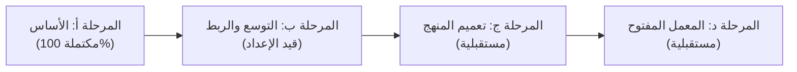
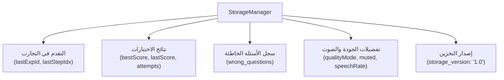
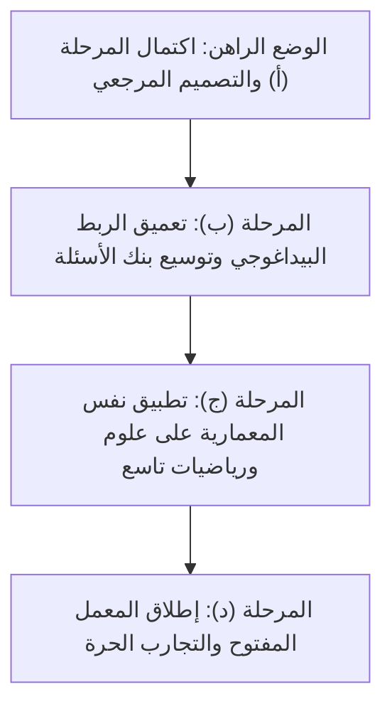

# تقرير الحالة الشامل لمشروع تطبيق "ذاكر" (Thaker)
### المنصة التعليمية التفاعلية ثلاثية الأبعاد – المنهج اليمني

---

## 1. نبذة تعريفية والهدف الاستراتيجي (Vision & Objectives)

### ما هو تطبيق "ذاكر"؟
**ذاكر** هو تطبيق تعليمي تفاعلي رقمي شامل موجه لطلاب المدارس في الجمهورية اليمنية، يدمج بين الكتب المدرسية الوزارية المعتمدة والمعامل الافتراضية ثلاثية الأبعاد (3D Interactive Laboratories) وأنظمة الاختبارات الوزارية المؤتمتة.

### الهدف الحالي (Current Mission)
1. **العمل دون اتصال بالإنترنت (100% Offline)**:
   - تمكين الطالب اليمني في كافة المحافظات من الوصول الكامل للكتب الدراسية، الشروحات، والمعامل التفاعلية دون الحاجة لأي اتصال بالشبكة، وتجاوز عقبات انقطاع الكهرباء والإنترنت.
2. **تجسيد المفاهيم المجردة (3D Visualization)**:
   - تحويل التجارب الكيميائية الخطرة أو المعقدة والمفاهيم الرياضية والفيزيائية المجردة إلى نماذج ومحاكاة لمسية حركية ثلاثية الأبعاد.
3. **الربط العضوي بين الكتاب والمعمل**:
   - القضاء على الفجوة بين حفظ النصوص وفهم التجارب، بحيث يستطيع الطالب أثناء قراءة صفحة الكتاب الانتقال بضغطة زر واحدة إلى التجربة المعملية المقابلة، وحل الأسئلة الوزارية المرتبطة بها.
4. **خدمة مرحلتين مفصليتين في مسار الطالب**:
   - **الصف الثالث الثانوي (علمي)**: معمل وكتاب الكيمياء المتقدم.
   - **الصف التاسع الأساسي**: المنهج الوزاري الكامل للعلوم والرياضيات (كتب PDF معجلة عتادياً + كتب تفاعلية 3D + اختبارات مؤتمتة).

---

## 2. أين نحن حالياً في مسار البناء (Current Progress & Milestones)



### ✅ الإنجازات المكتملة حتى اللحظة:

1. **المرحلة (أ): بناء الأساس المعياري (Production Foundation)**:
   - **تفكيك النموذج الأولي الأحادي**: تم تحويل ملف الكيمياء من ملف مفرد ضخم ومتشابك إلى بنية معيارية نظيفة قابلة للصيانة في مسار [`chem-lab/src/`](file:///mnt/sdcard/projects/teaching-app/chem-lab/src):
     - فصل الـ HTML في [`src/index.html`](file:///mnt/sdcard/projects/teaching-app/chem-lab/src/index.html).
     - فصل الأنماط بالكامل في [`src/styles.css`](file:///mnt/sdcard/projects/teaching-app/chem-lab/src/styles.css) بالاعتماد على متغيرات الثيم.
     - فصل منطق المحرك ثلاثي الأبعاد في [`src/app.js`](file:///mnt/sdcard/projects/teaching-app/chem-lab/src/app.js).
     - استخراج صور صفحات الكتاب الوزاري الـ 20 كملفات مستقلة في [`src/assets/pages/`](file:///mnt/sdcard/projects/teaching-app/chem-lab/src/assets/pages).
     - عزل مكتبة Three.js r128 في [`src/vendor/three.min.js`](file:///mnt/sdcard/projects/teaching-app/chem-lab/src/vendor/three.min.js).
   - **بناء خط إنتاج آلي ([`build.py`](file:///mnt/sdcard/projects/teaching-app/chem-lab/build.py))**:
     - سكريبت بايثون يجمع الملفات المصدرية، ويشفر الصور تلقائياً إلى Base64 Data URIs، لينتج ملفاً مستقلاً موحداً في [`dist/chem-lab-book.html`](file:///mnt/sdcard/projects/teaching-app/chem-lab/dist/chem-lab-book.html) بحجم 2.59 ميجابايت يعمل بدون أي خادم أو شبكة.
   - **إصلاح المشكلات الحرجة**:
     - حل مشكلة تباين نصوص الاختبارات في الوضعين الفاتح والداكن.
     - استبدال خوارزمية الفرز غير المنضبطة بـ Fisher-Yates العادلة.
     - تصحيح رف أدوات المعمل بربط الأحداث المباشر `addEventListener`.
     - ربط خلفية المشهد بمتغيرات النظام عبر `matchMedia`.
   - **التحقق الآلي العميق ([`test_chem_full.js`](file:///mnt/sdcard/projects/teaching-app/chem-lab/test_chem_full.js))**:
     - اجتياز 7 حزم اختبارات آلية بنسبة 100% (فحص التجارب العشر، خطواتها، مخطط الأسئلة، نظام التخزين، أوضاع الجودة، ومراجعة الأخطاء).

2. **التطابق البصري التام مع نموذج التصميم (`prototipe.for.image.png`)**:
   - إعادة بناء الواجهة الرئيسية لتطبيق أندرويد بالكامل لتتطابق في كل عنصر ولون مع النموذج المرجعي:
     - الهيدر العلوي العائم النقي مع الشعار وأزرار الـ Squircle للملف الشخصي والإشعارات.
     - البطاقة البارزة العلوية (Hero Card) متضمنة رسم الدورق ثلاثي الأبعاد المضيء والشارات الكبسولية.
     - محدد المرحلة التعليمية الكبسولي (الثانوية / الإعدادية).
     - بطاقة المعمل والكتاب المميزة مع شريط المرجعية وزر `فتح المعمل ▶` وشريط التشغيل التلقائي.
     - بطاقات المواد للفيزياء والأحياء بأيقونات وألوان الـ Squircle المخصصة.
     - شريط التنقل السفلي العائم (Dock Bar) مع زر "الرئيسية" الزمردي الدائري المرتفع ذو الهالة المضيئة.
   - بناء وتوقيع حزمة التطبيق النهائية [`Thaker.apk`](file:///mnt/sdcard/projects/teaching-app/Thaker.apk) بحجم 95.44 ميجابايت بنجاح تام.

---

## 3. هيكلية البيانات والبنية البرمجية (Data Architecture)

### أ. مخطط بنك الأسئلة الموحد (`questions.json`)
تم اعتماد هيكلية بيانات صارمة قابلة للتوسع والربط:

```json
{
  "schema_version": "1.0",
  "subject": "chemistry",
  "grade": "12",
  "questions": [
    {
      "id": "chem-q1",
      "unitId": 1,
      "expId": "exp-1",
      "page": 22,
      "difficulty": "medium",
      "q": "ما هو لون الراسب المتكون عند إضافة هيدروكسيد الصوديوم إلى محلول يحتوي على أيونات الحديد (III)؟",
      "options": [
        "بني محمر جيلاتيني",
        "أبيض مخضر",
        "أزرق فاتح",
        "أصفر باهت"
      ],
      "answer": 0,
      "explain": "يتفاعل هيدروكسيد الصوديوم مع أيونات الحديد الثلاثي Fe³⁺ ليعطي راسباً بنياً محمراً: Fe³⁺ + 3OH⁻ → Fe(OH)₃↓",
      "reviewed": false
    }
  ]
}
```

> [!NOTE]
> تم وضع `reviewed: false` لجميع الأسئلة الـ 20 لضمان عدم اعتمادها النهائي إلا بعد مراجعة لجان التوجيه التربوي بالوزارة. وتم ربط التجارب المؤكدة فقط (`exp-1`, `exp-2`, `exp-4`, `exp-6`, `exp-8`, `exp-9`, `exp-10`) بحقل `expId` وترك البقية `null` دون أي تخمين.

---

### ب. هيكلية إدارة التخزين وحفظ التقدم (`StorageManager`)
تعمل بنظام حماية متعدد المستويات (`try/catch` مع بديل ذاكرة مؤقتة `In-Memory Fallback`):



- **مفتاح الإصدار**: `thaker_storage_version: "1.0"`.
- **المعالجة الذاتية**: في حال تم تقييد `localStorage` داخل بيئة الـ WebView في أجهزة أندرويد القديمة، يستمر التطبيق بالعمل طبيعياً عبر الذاكرة الداخلية دون انهيار أو توقف.

---

### ج. هيكلية وحدات المعامل والمناهج ثلاثية الأبعاد (3D Curriculum Engine)
مبنية داخل محركات العرض (`science-9th-book.html`, `math-9th-book.html`, `chem-lab-book.html`):

```javascript
{
  id: 'u1',
  part: 1,
  n: 1,
  title: 'المحاليل وطرق التعبير عنها',
  short: 'كيف يذوب المذاب؟ وكيف نحسب تركيز المحلول؟',
  concepts: [
    ['المفهوم الرئيسي', 'الشرح التفصيلي المبسط', 'التطبيق العملي']
  ],
  law: 'التركيز (جم/لتر) = كتلة المذاب (جم) ÷ حجم المحلول (لتر)',
  apps: ['المحاليل الطبية', 'العصائر', 'مواد التنظيف'],
  lab: {
    title: 'مختبر المحاليل والتركيز',
    controls: [['amount', 'كمية المذاب', 0, 30, 10, '']],
    steps: ['أضف المذاب', 'حرّك المحلول', 'ارفع الحرارة'],
    build: 'solutions'
  },
  quiz: [ /* أسئلة تفاعلية مع تفسير علمي لكل خيار */ ]
}
```

---

### د. محرك ضبط الأداء التلقائي (`QualityManager`)
- **المستويات الثلاثة**:
  - `low`: بكسل 1.0، إيقاف الظلال (للأجهزة الضعيفة والاقتصادية).
  - `medium`: بكسل 1.5، خريطة ظلال 1024.
  - `high`: بكسل حتى 2.0، خريطة ظلال ناعمة 2048.
- **الرصد اللحظي**: نافذة متدحرجة لـ 60 إطاراً؛ إذا انخفض المعدل عن 28 FPS، يقترح التطبيق تلقائياً التحويل للوضع المنخفض لضمان استقرار وسلاسة الحركة.

---

## 4. جرد المكونات والأصول المتوفرة لدينا حالياً (Asset Inventory)

| الفئة | العنصر / الملف | الحجم / الحالة | الوصف والدور |
| :--- | :--- | :--- | :--- |
| **تطبيق أندرويد** | [`Thaker.apk`](file:///mnt/sdcard/projects/teaching-app/Thaker.apk) / [`ذاكر.apk`](file:///mnt/sdcard/projects/teaching-app/%D8%B0%D8%A7%D9%83%D8%B1.apk) | **95.44 MB** | حزمة أندرويد متكاملة وموقعة تضم المنهج الكامل للمرحلتين. |
| **سورس أندرويد** | [`thaker-android-src/`](file:///mnt/sdcard/projects/teaching-app/thaker-android-src) | كود جافا أصيل | كود الأنشطة: `MainActivity`, `LabActivity`, `BookViewerActivity`, `QuizActivity`, `SummaryActivity`, وموارد التصميم. |
| **أداة البناء** | [`build_apk.py`](file:///mnt/sdcard/projects/teaching-app/build_apk.py) | 222 KB | سكريبت البناء الشامل لحزمة أندرويد مع أداة aapt2, d8, zipalign, apksigner. |
| **كيمياء 3D مجمعة** | [`dist/chem-lab-book.html`](file:///mnt/sdcard/projects/teaching-app/chem-lab/dist/chem-lab-book.html) | **2.59 MB** | معمل وكتاب الكيمياء المستقل (المرحلة أ) متضمن صور الصفحات الـ 20 ومكتبة Three.js. |
| **سورس الكيمياء** | [`chem-lab/src/`](file:///mnt/sdcard/projects/teaching-app/chem-lab/src) | معياري | الهيكل المصدر: `index.html`, `styles.css`, `app.js`, `questions.json`, `assets/pages/`. |
| **تجارب الكيمياء** | 10 تجارب 3D تفاعلية | مكتملة 100% | الكشف عن الحديد، حرارة الذوبان، الأكسدة والاختزال، دانيال، المركم، هوفمان، الطلاء، النشا، الصابون، التقطير. |
| **علوم تاسع 3D** | [`science-9th-book.html`](file:///mnt/sdcard/projects/teaching-app/science-9th-book.html) | 715 KB | معمل وكتاب العلوم ثلاثي الأبعاد للصف التاسع متضمناً 13 وحدة دراسية وتجارب محاكاة. |
| **معمل علوم تاسع** | [`science9-interactive.html`](file:///mnt/sdcard/projects/teaching-app/science9-interactive.html) | 670 KB | 13 درساً تفاعلياً ثلاثي الأبعاد مبسط مع أسئلة لكل درس. |
| **رياضيات تاسع 3D** | [`math-9th-book.html`](file:///mnt/sdcard/projects/teaching-app/math-9th-book.html) | 687 KB | معمل وكتاب الرياضيات ثلاثي الأبعاد متضمناً مخططات فِن التفاعلية ونظريات الدائرة والهندسة. |
| **كتب علوم تاسع الوزارية** | `science_part1_9th.pdf`<br/>`science_part2_9th.pdf` | **25.2 MB**<br/>**51.1 MB** | الكتب الوزارية الرسمية الصادرة عن وزارة التربية والتعليم مدمجة للقراءة دون اتصال. |
| **كتب رياضيات تاسع** | `mathematics_part1_9th.pdf`<br/>`mathematics_part2_9th.pdf` | **10.0 MB**<br/>**6.8 MB** | الكتب الوزارية الرسمية للرياضيات بجزأيها الأول والثاني مدمجة. |
| **الرسوم والواجهات** | [`app_home_prototype_render.png`](file:///mnt/sdcard/projects/teaching-app/app_home_prototype_render.png) | 42 KB | معاينة الواجهة المطابقة للنموذج المرجعي `prototipe.for.image.png`. |
| **شاشات التحقق** | [`screenshots/`](file:///mnt/sdcard/projects/teaching-app/chem-lab/screenshots) | صور PNG | لقطات شاشة لنافذة الاختبارات بالوضعين الفاتح والداكن بدقة ألوان كاملة. |

---

## 5. الخطوات القادمة وخريطة الطريق (Next Steps & Roadmap)



1. **المرحلة (ب) - تعميق الربط وتوسيع بنك الأسئلة**:
   - مراجعة واعتماد الأسئلة الـ 20 مع معلمي الكيمياء لتصبح `reviewed: true`.
   - استكمال أسئلة الوحدات الشحيحة (الوحدات التي تحتوي أقل من 3 أسئلة حالياً).
2. **المرحلة (ج) - تعميم المعمارية على علوم ورياضيات تاسع**:
   - تطبيق نفس البنية المعيارية (`src/`, `build.py`, `questions.json`) على ملفي [`science-9th-book.html`](file:///mnt/sdcard/projects/teaching-app/science-9th-book.html) و [`math-9th-book.html`](file:///mnt/sdcard/projects/teaching-app/math-9th-book.html).
3. **المرحلة (د) - التجربة المعملية الحرة (Free Lab Sandbox)**:
   - إعادة تفعيل زر "تجربة حرة" الذي تم إخفاؤه مؤقتاً، وتزويده بمحرك مزج كيميائي تفاعلي حر.
